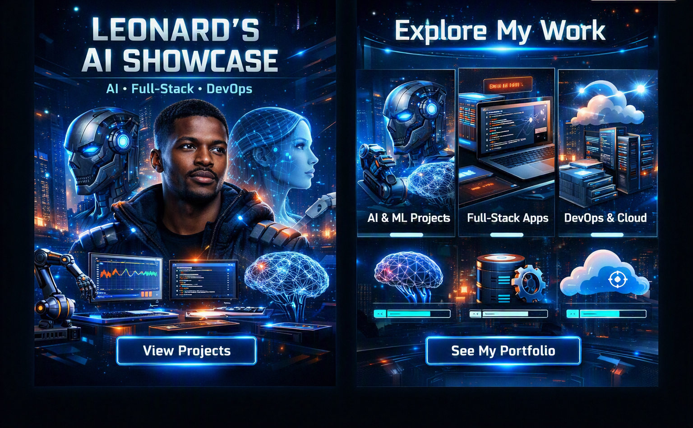

# Leonard Phokane | AI/ML Engineer & Full-Stack Developer Portfolio


A production-grade, highly responsive personal portfolio website showcasing expertise in artificial intelligence, machine learning classification pipelines, high-throughput backend architecture, and modern full-stack web applications.

Built with clean modular separation (`index.html`, external CSS, and modular JavaScript) and a dark glassmorphism aesthetic powered by Tailwind CSS.

---

## 🌐 Live Demo:


---

## 🚀 Features

* **Interactive Hero Section:** Dynamic profile presentation with live operational badge and quick action buttons.
* **Filterable Technical Skills Matrix:** Interactive category toggles for AI & Machine Learning, Backend, Frontend, Cloud/DevOps, and Databases.
* **Featured Projects Showcase:** Comprehensive cards detailing real-world engineering work (Visual AI Flow Builder, Metering & Billing Engines, ML Pipelines) with interactive architecture modal drawers.
* **Professional Experience Timeline:** Detailed career history across internships and independent software engineering tracks.
* **Verified Credentials & Certifications:** Interactive achievement badges for IBM, Cisco, Anthropic, and engineering internships.
* **Fully Responsive & Accessible:** Optimized layouts for mobile navigation and desktop viewing with smooth scrolling.

---

## 📁 Repository Structure

```text
ai-software-engineer-portfolio/
├── index.html              # Main HTML entry point & structure
├── assets/
│   ├── images/
│   │   └── profile.jpg     # Leonard Phokane profile photograph
│   ├── css/
│   │   └── styles.css      # Modular custom CSS styling & scrollbars
│   └── js/
│       └── app.js          # Interactive UI logic, modals, filtering, & toasts
├── README.md               # Project documentation
└── LICENSE                 # Open-source MIT license

---

🛠️ Local Development & Setup
1. Clone or Download this repository into your local machine.
2. Ensure your profile image is correctly placed at:
   ```text
   ai-software-engineer-portfolio/assets/images/profile.jpg

   ```
   
   ---

## 👨🏾‍💻 Author

<p align="center">
  
</p>

**Leonard Phokane**  
*AI/ML Engineer | Backend Architect | Full-Stack Developer*

- **GitHub:** `[@leonardphokane](https://github.com/leonardphokane)`
- **LinkedIn:** `[Leonard Phokane](https://linkedin.com/in/leonard-phokane)`
- **Email:** `[leonardphokane1@gmail.com](mailto:leonardphokane1@gmail.com)`
- **Location:** `Tembisa / Johannesburg, South Africa (Remote-friendly)`

`© 2026 Leonard Phokane. All rights reserved.`